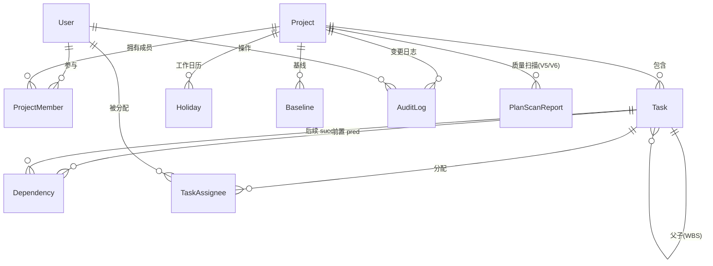

# 简易 Web 版 Project 系统 —— 技术调研与设计文档

| 项 | 内容 |
| --- | --- |
| 版本 | v1.1（新增 TASK 字段规范与三级校验规则） |
| 日期 | 2026-11-03 |
| 状态 | 待评审 |
| 已确认决策 | 技术栈：Next.js 全栈单体（TS + Prisma + SQLite/PG）；使用范围：小团队多人协作（登录 + 权限）；排期能力：FS 依赖 + 工期推算 + 初验点冲击分析 |
| v1.1 变更 | ① TASK 必备字段规范（10 个字段，见 [5.4](#54-task-必备字段规范)）；② 三级校验规则体系——必须 / 建议 / 自动扫描（见第 7 章）；③ 可选接入 DeepSeek 做 WBS 分解质量扫描 |

---

## 1. 背景与目标

### 1.1 需求拆解

用户原始需求："实现项目计划的制定和追踪"，含 5 条基本功能。逐条转译为可设计的系统能力：

| # | 原始需求 | 系统能力 | 对应模块 |
| --- | --- | --- | --- |
| 1 | 工作分解（WBS） | 多层级任务树：新增/删除/重命名、缩进降级、拖拽排序、WBS 编码自动生成、父节点工期自动汇总 | M2 |
| 2 | 填写项目开工会起点 | 项目级"起始里程碑"：作为所有无前置任务的默认起点，日期落库于项目 | M3 |
| 3 | 安排工作项目的起止时间和时长，安排人员依赖 | 任务工期（工作日）+ 主责人/协办人 + 前置依赖（FS + 滞后量）；起止时间由排期引擎推算而非手填 | M4 |
| 4 | 填写项目初验点，形成完整甘特图 | 项目级"目标里程碑"（初验点），甘特图渲染：层级、时间轴、进度条、依赖箭头、里程碑菱形、初验点竖线 | M3 / M5 |
| 5 | 过程中细化/新增工作项、调时长、调依赖，自动刷新甘特图并识别是否影响初验 | 变更预览（Impact Report）→ 确认落库 → 全图重算 → 若冲击初验点则高亮延期天数与责任任务 | M6 |

### 1.2 范围界定

**In Scope（v1）**
- 单项目维度的计划制定与追踪（多项目并存，但项目间不联动）
- WBS 分解、里程碑、工期、FS 依赖、人员分配
- 自动排期（正推/逆推）、关键路径、初验点冲击分析
- 甘特图可视化与编辑、基线快照、变更审计

**Out of Scope（v1 明确不做，架构预留）**
- 资源平衡（Resource Leveling）与人力投入曲线（S 曲线、资源直方图）
- 工时填报与成本核算（EVM：SPI/CPI）
- SS / FF / SF 依赖与多项目资源冲突协调
- 与 MS Project / Jira 双向同步（仅做单向导出）

### 1.3 角色定义

| 角色 | 说明 | 典型操作 |
| --- | --- | --- |
| OWNER | 项目创建者 | 项目设置、成员管理、删除项目 |
| PM | 项目经理 | WBS 全量编辑、设初验点、调依赖、建基线 |
| MEMBER | 项目成员 | 更新自己负责任务的进度、实际起止 |
| VIEWER | 只读 | 查看甘特图、导出 |

### 1.4 补充需求（v1.1）：数据字段与校验规则

**数据要求**：TASK 对象至少包含 序号、进度、项目描述、起始时间、终止时间、时长、资源、前级依赖、是否里程碑、进展描述 —— 共 10 个字段，字段规范与落库映射见 5.4。

**校验规则**（在数据修改与界面调整时生效），按强制程度分三级：

| 级别 | 规则 | 违反后果 | 编号 |
| --- | --- | --- | --- |
| 必须遵循 | 除第一个 TASK（启动会/开工会）外，其余 TASK 必须有前级依赖 | 阻断保存 | V1 |
| 必须遵循 | 不能出现循环依赖 | 阻断保存（连线时即禁止） | V2 |
| 建议遵循 | 一周内的工作，必须分解到 3 天内粒度 | 提示框，人工确认后可强行更改 | V3 |
| 建议遵循 | 过程中的 TASK 修改，不能修改起始时间、终止时间（只能通过调整依赖和时长间接改变） | 提示框，人工确认后可强行更改 | V4 |
| 自动扫描 | 检查分解的子项是否是并列关系 | 仅提示（可引入 DeepSeek 等外部模型判断） | V5 |
| 自动扫描 | 检查分解的子项完成是否能确保父项完成，若否提出建议 | 仅提示（可引入 DeepSeek 等外部模型判断） | V6 |

详细判定口径、校验时机与实现方案见第 7 章。

---

## 2. 技术调研

### 2.1 架构形态对比

| 方案 | 优点 | 缺点 | 结论 |
| --- | --- | --- | --- |
| 纯前端 SPA（IndexedDB） | 零运维、离线可用、开发最快 | 无多人协作、无权限、数据易丢 | 淘汰（与"多人协作"决策冲突） |
| 前后端分离（SPA + 独立 API） | 分工清晰、可独立扩容 | 两套工程、联调成本、类型需跨端同步 | 备选 |
| **TS 全栈单体（Next.js + Prisma）** | 一套语言/一套类型；Server Actions 免手写 API 层；部署为单进程/单容器；后期可平滑切 PG | 前后端耦合，重型计算需另拆 | **选定** |
| Java 企业栈（Spring Boot + MySQL + Vue） | 贴合传统企业 IT 规范 | 开发与部署重，与"简易"目标不符 | 淘汰 |

选型理由：本项目核心复杂度在**排期算法与交互式甘特图**，而非分布式或高并发。单体架构能让排期算法以"同构纯函数"形式前后端共用（见 6.5），显著降低一致性维护成本。

### 2.2 甘特图 / 排期可视化库调研

| 库 | 许可 | 能力 | 性能 | 适配度 |
| --- | --- | --- | --- | --- |
| Frappe Gantt | MIT | 轻量 SVG 时间线，依赖支持弱 | 大数据集表现差 | 快速原型可用，定制成本高 |
| gantt-task-react | MIT | 简单 React 组件，适合内嵌时间线 | 中等 | 依赖箭头能力弱 |
| DHTMLX Gantt | GPLv2 或商业授权 | 功能最全（依赖、关键路径、基线） | 强，但删除外操作较重 | 商业化需付费，GPLv2 会传染 |
| Bryntum Gantt | 商业（perpetual / OEM 订阅） | 旗舰级，主题丰富 | 强 | 授权成本高 |
| Syncfusion Gantt | 商业订阅 | 功能全，压测表现好 | 强 | 授权成本高 |
| **自研渲染层（CSS Grid 时间轴 + SVG 依赖箭头）** | 自有 | 完全可控：关键路径红色高亮、初验点竖线、基线对比条、影响预览气泡都能精确实现 | 需自己做虚拟化 | **v1 推荐** |

> 调研来源见第 12 节。关键判断：本系统的差异化能力是**关键路径高亮 + 初验点冲击可视化 + 变更影响预览**，通用库在这三点的定制成本往往高于自研一个"够用"的渲染层。且"简易 Project"的图形需求有限（时间轴 + 层级 + 条 + 箭头 + 里程碑），自研可控性最高。
> 兜底策略：若排期确定要加快落地，可先用 gantt-task-react / Frappe Gantt 承载只读展示（M2），编辑交互（M3）再替换为自研渲染层——渲染层与排期引擎解耦，替换成本被隔离在 `components/gantt/` 目录内。

### 2.3 排期算法调研

- **依赖语义**：v1 仅启用 FS（Finish-to-Start，完成-开始）+ 滞后量 `lagDays`，对应"工作项依赖"最常见场景；表结构保留 `type` 字段，未来扩展 SS/FF/SF 不需改表。
- **工期口径**：工期按**工作日**计（`durationDays`），配合项目级工作日历（周一~周五位掩码 + 节假日表）。含首日口径：工期 1 天的任务 `start == end`。
- **正推（Forward Pass）**：按拓扑序计算最早开始 ES / 最早完成 EF。
- **逆推（Backward Pass）**：以**初验点日期**为项目完工约束，反推最晚开始 LS / 最晚完成 LF。
- **关键路径（CPM）**：总浮动时间 `TotalFloat == 0` 的任务构成关键路径——它们直接决定初验点，是"影响分析"的责任主体。
- **计算规模**：全图重算复杂度 `O(V + E)`，2000 任务量级为毫秒级，**不做增量优化**（避免过早复杂化）。

### 2.4 存储与部署

| 环境 | 数据库 | 说明 |
| --- | --- | --- |
| 本地开发 | SQLite（单文件） | 零依赖启动，Prisma 切换仅改 `provider` 与 `DATABASE_URL` |
| 生产（多人协作） | PostgreSQL | 需要并发写入、事务与行级锁；SQLite 并发写会锁库，不适合多人 |

部署形态：Docker 单容器（Next.js standalone）+ 反向代理；PostgreSQL 独立容器/托管实例，开启每日自动备份。

### 2.5 选型结论汇总

| 层 | 选型 | 备注 |
| --- | --- | --- |
| 框架 | Next.js（App Router）+ React + TypeScript | Server Components 读、Server Actions 写、Route Handler 仅用于导出/Webhook |
| UI | Tailwind CSS + shadcn/ui | 无样式锁定，甘特图自定义组件易融入 |
| 表单校验 | react-hook-form + zod | zod schema 前后端共用 |
| ORM / DB | Prisma + SQLite(dev) / PostgreSQL(prod) | 类型安全，迁移可版本化 |
| 认证 | Auth.js (NextAuth v5) Credentials + argon2 | 后续可加飞书/企业 SSO |
| 权限 | 项目级 RBAC（OWNER/PM/MEMBER/VIEWER） | 所有写操作入口统一鉴权 |
| 日期 | date-fns（不用 moment） | 工作日运算自实现于排期引擎 |
| 数据获取 | Server Components + TanStack Query（客户端编辑区） | 变更走 Server Action |
| 甘特图 | 自研渲染层（CSS Grid + SVG） | 见 2.2 |
| 外部模型（可选） | DeepSeek API（服务端调用，OpenAI 兼容协议） | 仅用于 V5/V6 计划质量扫描，默认关闭，见 7.4 |
| 异步任务 | 数据库任务表 + 定时轮询（v1 不引入队列中间件） | AI 扫描异步化，见 7.4 |
| 测试 | Vitest（算法单测优先）+ Playwright（E2E） | 排期引擎必须 100% 单测覆盖 |
| 部署 | Docker + Next.js standalone | — |

---

## 3. 总体架构

### 3.1 逻辑架构

```
┌─────────────────────────────────────────────────────────────┐
│ 浏览器                                                       │
│  ├─ 甘特图视图 (时间轴 + WBS 树 + SVG 依赖层)                │
│  └─ 影响预览面板 / 任务详情抽屉 / 基线对比 / 校验提示         │
│         │  ① 即时本地重算（排期引擎，同构）                   │
│         │  ② 即时本地校验（校验规则，同构）                   │
└─────────┼───────────────────────────────────────────────────┘
          │ Server Action（zod 校验 + 鉴权）
┌─────────▼───────────────────────────────────────────────────┐
│ Next.js 服务端（单进程）                                      │
│  ├─ app/(dash)/projects/[id]/...   页面与 Server Components  │
│  ├─ server/actions/*.ts            写操作（事务边界）         │
│  ├─ lib/scheduler/*.ts             排期引擎（纯函数，同构）   │
│  ├─ lib/validation/*.ts            校验规则 V1~V4（同构）     │
│  ├─ lib/scan/*.ts                  V5/V6 外部模型扫描（异步） │
│  ├─ lib/auth/*                     认证 + requireProjectRole │
│  └─ app/api/export/route.ts        导出 Route Handler         │
└─────────┬───────────────────────────────┬───────────────────┘
          │ Prisma                        │ HTTPS（仅 V5/V6，可选）
┌─────────▼───────────────────┐  ┌────────▼───────────────────┐
│ SQLite (dev) / PG (prod)    │  │ DeepSeek API（默认关闭）    │
└─────────────────────────────┘  └────────────────────────────┘
```

### 3.2 目录结构（约定）

```
src/
├─ app/
│  ├─ (auth)/login/page.tsx
│  ├─ (dash)/projects/[projectId]/
│  │   ├─ page.tsx                 # 甘特图主视图
│  │   ├─ tasks/page.tsx           # 任务表格视图
│  │   ├─ baselines/page.tsx
│  │   └─ settings/page.tsx        # 开工会/初验点/日历/成员
│  └─ api/export/route.ts
├─ components/
│  ├─ gantt/                       # 渲染层（可整体替换）
│  │   ├─ GanttChart.tsx
│  │   ├─ TimelineHeader.tsx
│  │   ├─ WbsTree.tsx
│  │   ├─ DependencyLayer.tsx      # SVG 箭头
│  │   └─ MilestoneMarker.tsx      # 初验点竖线
│  └─ ui/                          # shadcn
├─ lib/
│  ├─ scheduler/                   # 排期引擎（纯函数，同构）
│  │   ├─ calendar.ts              # 工作日历运算
│  │   ├─ topo.ts                  # 拓扑排序 + 环检测
│  │   ├─ forward.ts / backward.ts # 正推 / 逆推
│  │   ├─ impact.ts                # 冲击分析
│  │   └─ index.ts                 # computeSchedule() 入口
│  ├─ validation/                  # 校验规则体系（纯函数，同构）
│  │   ├─ types.ts                 # ValidationIssue / 级别定义
│  │   ├─ graph.ts                 # V1 前级依赖完整性、V2 环检测
│  │   ├─ granularity.ts           # V3 分解粒度
│  │   ├─ immutability.ts          # V4 过程任务起止时间不可直接改
│  │   └─ index.ts                 # validatePlan() 统一入口
│  ├─ scan/                        # V5/V6 计划质量扫描（服务端）
│  │   ├─ deepseek.ts              # 外部模型客户端
│  │   ├─ prompts.ts               # 提示词与输出 JSON Schema
│  │   └─ runner.ts                # 组装上下文 → 调用 → 落库
│  ├─ auth/  ├─ zod/ (表单 schema)  └─ db.ts
├─ server/actions/
└─ prisma/schema.prisma
```

---

## 4. 主要功能设计

### 4.1 功能模块清单

| 模块 | 名称 | 核心内容 | 对应需求 |
| --- | --- | --- | --- |
| M1 | 项目与成员管理 | 项目 CRUD、成员邀请与角色、项目设置（日历/口径） | — |
| M2 | WBS 工作分解 | 树形编辑器、增删改、缩进/升级、拖拽排序、WBS 编码自动生成、父节点汇总 | 需求 1 |
| M3 | 里程碑管理 | 开工会起点、初验点、任意中间里程碑；里程碑零工期，可作为依赖锚点 | 需求 2 / 4 |
| M4 | 排期与依赖 | 工期、约束（ASAP / MSO）、主责人与协办人、FS 依赖 + 滞后量；受 V1/V2 硬校验约束 | 需求 3 |
| M5 | 甘特图可视化 | 时间轴、层级折叠、进度条、依赖箭头、里程碑菱形、初验点竖线、关键路径高亮、今日线、基线对比条、校验问题标记 | 需求 4 |
| M6 | 变更与影响分析 | 编辑前实时预览（校验问题 + Impact Report）→ 建议级问题人工确认后强行保存 → 审计留痕 → 可回滚到基线 | 需求 5 |
| M7 | 进度填报 | 实际开始/完成、完成率、阻塞原因、**进展描述**；完成率自动联动父节点 | 追踪 |
| M8 | 基线与版本对比 | 保存基线快照、基线 vs 当前双条对比、偏差明细 | 追踪 |
| M9 | 导出 | PNG（甘特图）、Excel（任务表）、MS Project XML（可选） | — |
| M10 | 通知（可选） | 初验点风险触发通知（飞书/邮件） | — |
| M11 | 校验与计划质量扫描 | 三级校验规则引擎（V1~V6）；V5/V6 可选接入 DeepSeek 对 WBS 分解做并列性/完备性扫描 | v1.1 新增 |

### 4.2 关键流程

```
[建项目] 填项目名 + 开工会起点 + 初验点
   ↓
[M2] WBS 分解：逐层录入工作项（此时无日期）
   ↓
[M4] 逐项填：工期(工作日) + 主责人 + 前置依赖(可含滞后量)
   ↓
[排期引擎] 正推 → 得到每项计划起止 → 汇总节点 roll-up
   ↓
[M5] 甘特图成形：依赖箭头 + 里程碑 + 初验点竖线 + 关键路径(红)
   ↓
[逆推] 以初验点为约束反推浮动时间 → 无浮动者即关键路径
   ↓
[需求5 循环] 细化/新增工作项、改工期、改依赖
   ↓
[M11 校验] validatePlan() 三级规则（与 previewImpact 同一次往返）
   ├─ BLOCK   (V1 缺前级依赖 / V2 环依赖)  → 直接拒绝，指出违规任务与环路
   ├─ CONFIRM (V3 粒度 > 3 天 / V4 直接改起止时间) → 提示框，勾选"已知悉"后放行
   └─ INFO    (V5 并列性 / V6 完备性，AI 扫描)    → 非阻塞建议列表
   ↓
[M6] 保存前先"预览影响"：ImpactReport = {延期天数, 受影响任务, 关键路径变化}
   ├─ 未冲击初验点 → 绿色提示"初验点不受影响，余量 N 天"
   └─ 冲击初验点  → 红色警示"初验点将推迟 N 天"，列责任任务，给出建议（压缩关键路径工期/移除滞后）
   ↓
[确认] 落库 + 重算 + AuditLog（含 Impact 快照 + 本次已确认的 CONFIRM 规则编号）
   ↓
[异步] 若开启扫描 → 触发 V5/V6 → 结果写入 PlanScanReport → 甘特图/任务行以气泡提示
```

**校验时机（三档）**：① **输入即时校验**——前端本地跑 `validatePlan()`，BLOCK 立即禁用保存按钮、CONFIRM 弹窗、INFO 灰字提示，无常感受网络延迟；② **提交校验**——Server Action 内用同一份规则复算，BLOCK 拒绝落库，CONFIRM 需携带确认凭据（`acknowledgedIssueCodes`），否则拒绝；③ **发布校验**——"计划发布（Publish）"动作对全项目跑一次完整校验（含 V1 全图覆盖），BLOCK 未清空则不允许发布，保证对外承诺的计划是完整的。

### 4.3 权限矩阵

| 操作 | OWNER | PM | MEMBER | VIEWER |
| --- | :-: | :-: | :-: | :-: |
| 查看甘特图 / 导出 | ✅ | ✅ | ✅ | ✅ |
| 项目设置（日历、口径） | ✅ | ✅ | ❌ | ❌ |
| 修改**开工会起点 / 初验点** | ✅ | ✅ | ❌ | ❌ |
| WBS 增删改 / 排序 | ✅ | ✅ | ❌ | ❌ |
| 任务工期 / 依赖 / 人员分配 | ✅ | ✅ | 仅自己负责的任务 | ❌ |
| 进度填报 | ✅ | ✅ | 仅自己负责的任务 | ❌ |
| 创建/删除基线 | ✅ | ✅ | ❌ | ❌ |
| 成员管理 / 删除项目 | ✅ | ❌ | ❌ | ❌ |

实现方式：Server Action 入口统一调用 `requireProjectRole(projectId, minRole)`，权限不足抛 `ForbiddenError`（前端转为 toast）。

---

## 5. 主要数据结构

### 5.1 实体关系



### 5.2 设计取舍（重要）

1. **里程碑与任务同表**（`Task.taskType = MILESTONE`）：里程碑本质是"零工期、可被依赖的节点"。同表可让依赖图与甘特图渲染直接用一套逻辑，避免 `milestone` 与 `task` 两套依赖体系。
2. **汇总节点（SUMMARY）不参与拓扑排序**：父节点日期由子节点 roll-up（`min(child.start) ~ max(child.end)`），工期为派生值；不允许手工填工期与作为依赖目标，避免"父节点工期与子节点冲突"的经典坑。
3. **计划日期是计算结果，不是用户输入**：`plannedStart/plannedEnd/isCritical/totalFloatDays` 均为引擎写入的派生字段（数据库只读约定放在 Server Action 层强制，不依赖前端）。
4. **乐观锁 `version`**：多人协作下两人同时改同一任务，提交时 `where { id, version }` 条件更新，失败返回冲突让前端刷新重试。
5. **`Baseline.snapshot` 与 `AuditLog.impact` 用 Json**：快照结构随排期引擎演进，用 Json 避免为"历史快照"反复迁移表结构。
6. **依赖方向**：`predId → succId`，`@@unique([predId, succId])` 防重复边；环检测在应用层（排期引擎内）做，DB 层存关系。
7. **起止时间是纯派生字段**（对应校验规则 V4）：`plannedStart/plannedEnd` 不接受用户直接赋值，只响应 `durationDays` / 依赖边 / `constraintType` 的变化，由引擎重算后写入。UI 上这两个单元格只读，点击可展开"推算依据"（来自哪个前置任务、哪条依赖、多少滞后）。
8. **根任务唯一性约定**（规则 V1 的判定基础）：全项目恰好一个"根任务" = 开工会里程碑（`isKickoff = true` 且 `taskType = MILESTONE`），它是**唯一允许没有前级依赖**的 TASK；SUMMARY 汇聚节点不适用依赖规则（父节点不参与依赖图）。
9. **进度与进展描述分离**：`progressPct`（数值进度）与 `progressNote`（进展描述文字）分开存储，避免每次更新百分比都覆写文字说明；后续如需留痕可加 `TaskProgressLog` 明细表，v1 不做。
10. **"是否里程碑"与"是否汇总"用同一字段表达**：`taskType`（SUMMARY / TASK / MILESTONE）一个字段同时表达用户视角的"是否里程碑"与系统视角的"是否汇总节点"，避免两个布尔字段出现互斥冲突（如既是里程碑又是汇总）。

### 5.3 Prisma Schema（v1 草案）

```prisma
// ============ 用户与权限 ============
model User {
  id           String   @id @default(cuid())
  email        String   @unique
  name         String
  passwordHash String
  avatarUrl    String?
  createdAt    DateTime @default(now())

  memberships ProjectMember[]
  assignments TaskAssignee[]
  auditLogs   AuditLog[]
}

model ProjectMember {
  id        String   @id @default(cuid())
  projectId String
  userId    String
  role      Role     @default(MEMBER)
  joinedAt  DateTime @default(now())

  project Project @relation(fields: [projectId], references: [id], onDelete: Cascade)
  user    User    @relation(fields: [userId], references: [id], onDelete: Cascade)

  @@unique([projectId, userId])
}

enum Role {
  OWNER
  PM
  MEMBER
  VIEWER
}

// ============ 项目与工作日历 ============
model Project {
  id            String        @id @default(cuid())
  key           String        @unique          // 项目代号，如 PIS-2026
  name          String
  description   String?
  status        ProjectStatus @default(PLANNING)
  kickoffDate   DateTime                        // 开工会起点（起始里程碑）
  preAcceptDate DateTime                        // 初验点（目标里程碑）
  workweekMask  Int           @default(31)      // 位掩码，1=周一 … 64=周日；31=周一~周五
  maxLeafDays   Int           @default(3)       // 粒度阈值：叶子任务工期上限（校验规则 V3），可项目级覆盖
  aiScanEnabled Boolean       @default(false)   // 是否开启 V5/V6 外部模型扫描（默认关闭，隐私考虑）
  createdById   String
  createdAt     DateTime      @default(now())
  updatedAt     DateTime      @updatedAt

  tasks        Task[]
  members      ProjectMember[]
  holidays     Holiday[]
  baselines    Baseline[]
  auditLogs    AuditLog[]
  scanReports  PlanScanReport[]
}

enum ProjectStatus {
  PLANNING
  ACTIVE
  ON_HOLD
  CLOSED
}

model Holiday {
  id        String   @id @default(cuid())
  projectId String
  date      DateTime @db.Date
  name      String?
  project   Project  @relation(fields: [projectId], references: [id], onDelete: Cascade)

  @@unique([projectId, date])
}

// ============ WBS / 任务 / 里程碑 ============
model Task {
  id             String         @id @default(cuid())
  projectId      String
  parentId       String?
  wbsCode        String                          // 自动生成，如 1.2.3
  sortOrder      Int            @default(0)
  name           String
  description    String?
  taskType       TaskType       @default(TASK)
  status         TaskStatus     @default(NOT_STARTED)
  durationDays   Int            @default(1)      // 按工作日计；MILESTONE 恒为 0
  constraintType ConstraintType @default(ASAP)
  constraintDate DateTime?                       // 仅 MSO 时有值
  isKickoff      Boolean        @default(false)  // 起始里程碑标记（全项目唯一"根任务"）
  isPreAccept    Boolean        @default(false)  // 初验点里程碑标记

  // ↓ 人工填报字段
  progressPct       Int       @default(0)        // 进度（0~100）
  progressNote      String?                      // 进展描述
  progressUpdatedAt DateTime?                    // 进展描述最后更新时间

  // ↓ 排期引擎写入的派生字段（用户不可直接编辑）
  plannedStart   DateTime?
  plannedEnd     DateTime?      // 含首日
  scheduleSource Json?          // 推算依据：{ fromTaskId, depId, lagDays } | { constraint: "MSO" } | { anchor: "KICKOFF" }
  actualStart    DateTime?
  actualEnd      DateTime?
  isCritical     Boolean        @default(false)
  totalFloatDays Int?

  version   Int      @default(1)                 // 乐观锁
  createdAt DateTime @default(now())
  updatedAt DateTime @updatedAt

  project   Project        @relation(fields: [projectId], references: [id], onDelete: Cascade)
  parent    Task?          @relation("WbsTree", fields: [parentId], references: [id], onDelete: Cascade)
  children  Task[]         @relation("WbsTree")
  preds     Dependency[]   @relation("PredSide")
  succs     Dependency[]   @relation("SuccSide")
  assignees TaskAssignee[]

  @@index([projectId, parentId, sortOrder])
}

enum TaskType {
  SUMMARY     // 汇总/父节点，日期由子节点 roll-up
  TASK        // 普通工作项
  MILESTONE   // 里程碑，零工期
}

enum TaskStatus {
  NOT_STARTED
  IN_PROGRESS
  BLOCKED
  DONE
}

enum ConstraintType {
  ASAP   // 尽早开始（默认）
  MSO    // 必须开始于/不早于指定日期
}

model Dependency {
  id        String  @id @default(cuid())
  projectId String
  predId    String                                // 前置任务
  succId    String                                // 后续任务
  type      DepType @default(FS)                  // v1 仅启用 FS
  lagDays   Int     @default(0)                   // 滞后量，可为负（提前）

  pred Task @relation("PredSide", fields: [predId], references: [id], onDelete: Cascade)
  succ Task @relation("SuccSide", fields: [succId], references: [id], onDelete: Cascade)

  @@unique([predId, succId])
  @@index([projectId])
}

enum DepType {
  FS  // 完成-开始（v1 唯一启用）
  SS  // 开始-开始（预留）
  FF  // 完成-完成（预留）
  SF  // 开始-完成（预留）
}

model TaskAssignee {
  id            String  @id @default(cuid())
  taskId        String
  userId        String
  isOwner       Boolean @default(true)            // 主责（1 人）
  allocationPct Int     @default(100)             // 投入比例，v1 仅记录不参与排期

  task Task @relation(fields: [taskId], references: [id], onDelete: Cascade)
  user User @relation(fields: [userId], references: [id], onDelete: Cascade)

  @@unique([taskId, userId])
}

// ============ 基线 / 审计 ============
model Baseline {
  id          String   @id @default(cuid())
  projectId   String
  name        String
  snapshot    Json                                // [{taskId, wbsCode, start, end, durationDays}]
  reason      String?
  createdById String
  createdAt   DateTime @default(now())

  project Project @relation(fields: [projectId], references: [id], onDelete: Cascade)
}

model AuditLog {
  id         String   @id @default(cuid())
  projectId  String
  actorId    String
  action     String                               // TASK_CREATE / DURATION_UPDATE / DEP_ADD / MILESTONE_UPDATE ...
  targetType String
  targetId   String?
  before     Json?
  after      Json?
  impact     Json?                                // 当次变更的 ImpactReport 快照
  createdAt  DateTime @default(now())

  project Project @relation(fields: [projectId], references: [id], onDelete: Cascade)
  actor   User    @relation(fields: [actorId], references: [id])

  @@index([projectId, createdAt])
}

// ============ 计划质量扫描（V5 并列性 / V6 完备性，可选，见 7.4） ============
model PlanScanReport {
  id            String     @id @default(cuid())
  projectId     String
  scopeType     ScanScope                        // PROJECT | PARENT_TASK
  targetTaskId  String?                          // scopeType=PARENT_TASK 时的父节点
  scanType      ScanType
  status        ScanStatus @default(PENDING)     // 同一 (projectId, targetTaskId, scanType) 的未完成报告应用层去重
  model         String?                          // 如 "deepseek-chat"，记录以便复现
  promptVersion String?
  findings      Json?                            // [{ code, level:"INFO", message, targetTaskIds[], suggestion }]
  inputTokens   Int?
  outputTokens  Int?
  error         String?
  createdById   String
  createdAt     DateTime   @default(now())
  finishedAt    DateTime?

  project Project @relation(fields: [projectId], references: [id], onDelete: Cascade)

  @@index([projectId, status, createdAt])
}

enum ScanScope {
  PROJECT       // 全项目扫一遍
  PARENT_TASK   // 针对某个父节点的子项集合
}

enum ScanType {
  SIBLING_PARALLELISM // V5：子项是否为并列关系（互斥性 / 有无重叠重复）
  COMPLETENESS        // V6：子项全部完成后能否确保父项完成（穷尽性 / 缺项）
}

enum ScanStatus {
  PENDING
  RUNNING
  SUCCEEDED
  FAILED
}
```

### 5.4 TASK 必备字段规范

对应 v1.1 数据要求：TASK 对象至少包含 10 个字段。落库映射与展示口径如下。

| # | 字段（用户视角） | 落库字段 | 类型/口径 | 是否可编辑 | 说明 |
| :-: | --- | --- | --- | --- | --- |
| 1 | 序号 | `wbsCode`（+ `sortOrder`） | 字符串，如 `1`、`1.2`、`1.2.3` | 否（自动生成） | 采用 **WBS 编码作为序号**：结构性更强、拖拽后自动重算；纯"行号"由前端按渲染顺序生成，**不落库**，避免与树结构冲突。`sortOrder` 仅控制同级显示顺序 |
| 2 | 进度 | `progressPct` | 整数 0~100 | 是（人员/PM） | 叶子任务人工填报；父节点由子节点加权 roll-up |
| 3 | 项目描述 | `name` + `description` | 字符串 | 是（PM） | `name` 为表格中显示的"项目描述"短标题（必填）；`description` 为详细描述（选填，抽屉内编辑） |
| 4 | 起始时间 | `plannedStart`（计划）/ `actualStart`（实际） | 日期 | **否**（派生，见规则 V4） | 由排期引擎推算；UI 只读，点击可看 `scheduleSource` 推算依据 |
| 5 | 终止时间 | `plannedEnd`（计划）/ `actualEnd`（实际） | 日期（含首日） | **否**（派生，见规则 V4） | 同上；口径为"含首日"，工期 1 天时 `start == end` |
| 6 | 时长 | `durationDays` | 整数（工作日，≥1；里程碑=0） | 是（PM） | 唯一可手工调整的时间类字段，改它会联动重算起止时间 |
| 7 | 资源 | `TaskAssignee[]`（关联 `User`） | 一对多 | 是（PM） | v1 资源 = **人员**；1 名主责（`isOwner`）+ N 名协办。展示为"张三、李四"；非人力资源（设备/环境）留待后续扩展 |
| 8 | 前级依赖 | `Dependency[]`（`predId → 本任务`） | 一对多 | 是（PM） | 表格内以编码串展示：`1.2、1.3+2d`（`+2d` 为滞后量，`-1d` 为提前）；点击展开选择器 |
| 9 | 是否里程碑 | `taskType == MILESTONE` | 枚举 → 布尔 | 是（PM） | 由 `taskType`（SUMMARY/TASK/MILESTONE）表达，见 5.2 第 10 点；开工会/初验点另有 `isKickoff` / `isPreAccept` 标识 |
| 10 | 进展描述 | `progressNote`（+ `progressUpdatedAt`、`status`） | 文本 | 是（人员/PM） | 文字进展；与 `progressPct` 数值分离存储。`status` 提供结构化状态（未开始/进行中/阻塞/完成）供筛选 |

**表格视图列顺序（M5 / 任务页面）**：序号 | 是否里程碑 | 项目描述 | 进度 | 起始时间 | 终止时间 | 时长 | 资源 | 前级依赖 | 进展描述 | 状态 | 关键路径标记

**依赖取值口径**：里程碑 `durationDays = 0`；SUMMARY 节点不显示前级依赖列（置为 `—`）。

---

## 6. 核心算法设计

### 6.1 工作日历（calendar.ts）

```
workweekMask: 31 表示周一~周五工作
holidays: Set<yyyy-MM-dd>

isWorkday(d)        = mask.bit(d.weekday) && !holidays.has(d)
snapForward(d)      = d 若为工作日，否则顺延到下一个工作日
addWorkdays(start, n)  // n 为"工作日天数偏移"，含首日口径：
                       //   addWorkdays(start, 0) === snapForward(start)
                       //   addWorkdays(start, k) = 从 start 起第 k+1 个工作日
workdaysBetween(a, b)  // a、b 之间跨越的工作日数，用于浮动时间与滞后量
```

### 6.2 排期主流程（index.ts）

```
computeSchedule(project, tasks, dependencies) -> ScheduleResult
  1) 过滤 SUMMARY 节点（其日期由 roll-up 得出）
  2) order = topoSort(nodes, deps)          // Kahn 算法
       若存在环 → 抛 CyclicDependencyError（含环路任务列表，前端高亮）
  3) 正推：
     for t in order:
       base = 项目开工会起点
       for p in preds(t):
         cand = calendar.addWorkdays(p.EF, 1 + dep.lagDays)   // FS：完成后次日（+滞后）
         base = max(base, cand)
       if t.constraintType == MSO:
         base = max(base, calendar.snapForward(t.constraintDate))
       if t.taskType == MILESTONE:
         t.ES = base; t.EF = base            // 零工期
       else:
         t.ES = base
         t.EF = calendar.addWorkdays(t.ES, t.durationDays - 1)
  4) 逆推（以初验点为项目完工约束）：
     for t in reverse(order):
       if t 无后续: t.LF = project.preAcceptDate
       else:        t.LF = min(calendar.addWorkdays(s.LS, -(1 + lag)) for s in succs(t))
       t.LS = (MILESTONE ? t.LF : calendar.addWorkdays(t.LF, -(t.durationDays - 1)))
       t.totalFloatDays = calendar.workdaysBetween(t.ES, t.LS)   // 可为负
       t.isCritical = t.totalFloatDays <= 0
  5) roll-up 汇总节点：父节点 span = min/max(子节点 span)，progress 按子节点加权
  6) projectFinish = max(t.EF)，其中 t 为流向初验点的关键路径末端
  7) slackDays = calendar.workdaysBetween(projectFinish, preAcceptDate)
       slackDays >= 0 → 有余量；< 0 → 延期 |slackDays| 天
  8) 返回 { tasks, criticalPath[], slackDays, projectFinish, warnings[] }
```

### 6.3 初验点冲击分析（impact.ts）

`previewImpact(patch)` 与 `applyChange(patch)` 共用同一份计算，前者不落库、后者落库——保证"预览结果 == 落库结果"。

```ts
type ImpactReport = {
  expectedFinish: string;      // 变更后项目预计完工
  requiredFinish: string;      // 初验点
  slackDays: number;           // >0 有余量；<=0 延期
  isDelayed: boolean;
  delayDays: number;           // 相对基线的延期天数
  criticalPath: { taskId: string; wbsCode: string; name: string;
                  start: string; end: string; deltaDays: number }[];
  changedTasks: { taskId: string; wbsCode: string; name: string;
                  oldStart: string; newStart: string;
                  oldEnd: string;   newEnd: string; deltaDays: number }[];
  newlyCritical: string[];     // 本次新进入关键路径的任务
  noLongerCritical: string[];  // 本次脱离关键路径的任务
  warnings: string[];          // 环依赖 / 零工期 / 依赖指向汇总节点 等
};
```

判定规则：

| 场景 | 输出 |
| --- | --- |
| `slackDays > 0` | 绿色提示："初验点不受影响，尚有余量 N 个工作日" |
| `slackDays == 0` | 黄色提示："初验点无余量，任何关键路径任务延期都会直接推迟初验" |
| `slackDays < 0` | 红色警示："初验点将推迟 N 个工作日"，列出关键路径责任任务 + 建议（压缩关键路径工期 / 减少滞后量 / 拆分并行） |

### 6.4 边界与异常处理

> 与业务校验规则（第 7 章）的分工：本节处理**排期计算层面**的边界（引擎如何应对脏数据不崩），第 7 章处理**业务规则层面**的校验（是否允许这次修改发生）。两者独立，但错误信息需一致。

| 场景 | 处理 |
| --- | --- |
| 依赖成环 | 拓扑排序时检出，拒绝保存，返回具体环路任务链供前端高亮（业务入口拦截见 V2，7.2.2） |
| 非根任务无前级依赖 | 引擎将其视为"从开工会起点开始"的正常任务照常排期（不崩）；但业务校验 V1 会阻断保存（见 7.2.1） |
| 依赖指向 SUMMARY 节点 | 拒绝（汇总节点日期派生，作为依赖源不稳定），返回明确错误 |
| 工期为 0 的普通任务 | 强制修正为 1（或提示转为 MILESTONE） |
| 任务跨节假日/周末 | 由 `addWorkdays` 自动顺延，`changedTasks.deltaDays` 按**工作日**差呈现，避免"看起来多延了几天" |
| 任务已完成（DONE）后有新前置依赖 | 保留实际日期，仅对未开始任务重算，并在 warnings 中提示"存在已完成任务与计划冲突" |
| 删除被依赖的任务 | 级联删除其依赖边并提示受影响的后续任务列表 |
| 初验点被设置为早于开工会 | 拒绝保存 |

### 6.5 同构排期引擎（关键设计）

`lib/scheduler/**` 全部为**纯函数、零 IO、零框架依赖**：

- **前端**：编辑时立即在浏览器重算，实时刷新甘特图与影响面板（无网络往返，交互流畅）
- **服务端**：Server Action 落库前用同一份代码复算，作为权威结果写入 `plannedStart/plannedEnd/isCritical`

好处：一套算法一处维护，前后端不可能算出不同结果；算法可被 Vitest 全量单测覆盖。

---

## 7. 数据校验规则体系

### 7.1 三级校验模型

| 级别 | 语义 | UI 表现 | 能否绕过 | 落库留痕 |
| --- | --- | --- | --- | --- |
| `BLOCK` | 必须遵循，违反即拒绝 | 保存按钮禁用 / 就地红字错误 | ❌ 不可绕过 | 不需要（未落库） |
| `CONFIRM` | 建议遵循，人工确认后可强改 | 模态确认框，需勾选"我已知悉并确认继续" | ✅ 可绕过 | ✅ `AuditLog.action = OVERRIDE_*`，记录被绕过的规则编号 |
| `INFO` | 不强制，自动扫描提示 | 行内黄色气泡 / 侧栏建议清单 | ✅ 完全非阻塞 | 写入 `PlanScanReport` |

统一的规则返回结构（前后端同构）：

```ts
type IssueLevel = 'BLOCK' | 'CONFIRM' | 'INFO';

type ValidationIssue = {
  code: 'V1_NO_PREDECESSOR' | 'V2_DEP_CYCLE' | 'V3_GRANULARITY'
      | 'V4_DIRECT_DATE_EDIT' | 'V5_NOT_PARALLEL' | 'V6_NOT_COMPLETE';
  level: IssueLevel;
  message: string;              // 面向用户的中文说明
  targetTaskIds: string[];      // 定位到具体任务，供 UI 高亮
  suggestion?: string;          // 修复建议
  detail?: unknown;             // 如环路路径、超限工期数值
  overridable: boolean;         // = level !== 'BLOCK'
};
```

唯一入口：`validatePlan(input) -> ValidationIssue[]`，`lib/validation/index.ts` 导出，**纯函数、零 IO**，前端即时校验与服务端提交校验共用（见 7.5）。

### 7.2 必须遵循的规则（BLOCK）

#### 7.2.1 V1 — 除第一个 TASK 外，其余 TASK 必须有前级依赖

**判定口径**

```
根任务 (rootTask) := task.isKickoff = true 且 task.taskType = MILESTONE   // 全项目恰好 1 个，即开工会
违规 := ∃ task ∈ 项目任务集 满足:
        task.taskType ≠ SUMMARY          // 汇总(父)节点不参与依赖图，天然豁免
    AND task.id ≠ rootTask.id            // 根任务豁免
    AND task.preds.length == 0           // 无任何前级依赖
```

**为什么汇总节点豁免**：SUMMARY 的工期/日期由子节点 roll-up，它不参与拓扑排序（见 5.2 第 2、8 点），要求它有前级依赖在语义上无意义。规则只约束**可执行的任务与里程碑**。

**录入体验的兼容设计**（避免硬规则让录入变得难用）：新增任务时**默认预填"当前选中任务"作为前级依赖**；用户也可批量选择同级前驱。这样"必须有前级依赖"在实际操作中是零成本满足的，而不是每次都要额外点一次。

**校验时机**：遵循 4.2 的"三档校验"，即新增/编辑保存时（BLOCK 立即拦截）+ **计划发布（Publish）时全项目复检**。发布校验是为了兜住"历史数据 / 导入数据 / 删除依赖后遗留"的漏网情况——发布前必须清零所有 V1 违规。

**例外清单**：① 根任务；② SUMMARY 节点；③ 外部导入的中间态（导入允许先落库为"待补依赖"，由发布校验拦截，UI 以橙色标记）。

#### 7.2.2 V2 — 不能出现循环依赖

**判定算法**：在"待插入依赖边 `(pred → succ)`"时，从 `succ` 出发做 DFS/BFS 可达性搜索，若可达 `pred` 则构成环，**拒绝该边**。复杂度 `O(V+E)`，可在 UI 连线过程中的毫秒级完成。

**UI 时的即时阻断**：拖拽连线到非法目标时，光标变禁止态并提示"将形成循环依赖：1.2 → 1.4 → 1.2"，同时在甘特图上临时高亮该环路路径。用户在"还没提交"时就已被拦住，而不是提交后才报错。

**兜底**：若历史/导入数据已存在环，拓扑排序失败时抛出 `CyclicDependencyError`（携带环路任务链），排期结果整体降级为"不可计算"，UI 红色横幅提示并提供"一键移除环路中某条依赖边"的修复入口（由 PM 选择移除哪条）。

**其他环来源排查**：WBS 父子关系是树结构，不可能成环；`TaskAssignee` 等关联表也不参与。故环只可能来自 `Dependency` 边——判定范围明确，无需全图关系扫描。

### 7.3 建议遵循的规则（CONFIRM）

#### 7.3.1 V3 — 一周内的工作必须分解到 3 天以内粒度

**适用对象**：叶子任务（`taskType == TASK`）；SUMMARY（由子项决定粒度）与 MILESTONE（零工期）不适用。

**判定**：`task.durationDays > project.maxLeafDays`（默认 `maxLeafDays = 3`，项目级可覆盖）。

**提示分级**（均为 `CONFIRM`，均可强行保存）：

| 条件 | 提示语 |
| --- | --- |
| `3 < durationDays ≤ 5` | "该工作项在**一周内**，建议拆分到 3 个工作日以内的粒度。是否继续？" |
| `durationDays > 5` | "该工作项跨 N 个工作日，超出建议粒度较多，建议拆分为多个 ≤3 工作日的子项。是否继续？" |

**强行保存**：`AuditLog.action = 'OVERRIDE_GRANULARITY'`，记录任务、实际工期与阈值，便于后续回顾计划质量。

> **口径待确认**：原文"一周内的工作，必须分解到 3 天内粒度"存在两种读法——(a) 工期 ≤5 工作日的任务要求拆到 ≤3 天；(b) 只要工期 >3 天就提示。本设计采用 **(b) 为主 + (a) 的文案分级**，即 `maxLeafDays` 是唯一阈值，`5` 只用于区分提示语强度。若希望严格按 (a) 执行（仅对 ≤5 天的任务提示），实现只需在判定上加一个上界条件。

#### 7.3.2 V4 — 过程中的 TASK 修改，不能修改起始时间、终止时间

**核心设计：区分"变更来源"，而不是简单禁止**

| patch 内容 | 判定 | 原因 |
| --- | --- | --- |
| 显式包含 `plannedStart` / `plannedEnd` | **触发 CONFIRM** | 这是"直接手改日期"，规则要拦截的行为 |
| 仅含 `durationDays` / 依赖边 / `constraintType` | 合规，不触发 | 起止时间由引擎重算得出，属于规则允许的调整路径 |

**"过程中的 TASK"定义**（满足任一即视为进行中）：① 存在基线快照；② `actualStart != null`；③ `status != NOT_STARTED`；④ 所属项目 `status == ACTIVE` 且任务的计划开始日已过。

**强行指定的优雅落地**：当 PM 确认"我确实要指定日期"时，**不直接写 `plannedStart`，而是自动为该任务创建 `constraintType = MSO` + `constraintDate`**（对齐 MS Project 的"手工排期"语义）。这样：

- 派生字段的纯洁性得以保持（起止时间永远由引擎算出来，见 5.2 第 7 点）
- 用户的主观意图（"这天之前不能开始"）被结构化保存，后续工期/依赖变化时仍能正确重算
- 审计里留下的是"增加了一条 MSO 约束"这一可解释的变更，而不是一次可疑的日期覆写

**UI 表现**：起止时间单元格默认只读；双击弹出说明"起止时间由**时长**与**前级依赖**推算，请调整时长或依赖来改变它"，并提供次要按钮"我要强制指定日期（将转为一个不早于约束）"——仅 PM+ 可见，点击后走 CONFIRM 确认框。

### 7.4 自动扫描提示（INFO，可接入外部模型）

#### 7.4.1 V5 — 检查分解的子项是否是并列关系

**扫描对象**：同一父节点下的全部子项集合（`scopeType = PARENT_TASK`）。

**要识别的问题类型**：

| code | 含义 | 例子 |
| --- | --- | --- |
| `OVERLAP` | 子项语义重叠/重复 | "需求评审" 与 "需求确认会" 高度重合 |
| `GRANULARITY_MISMATCH` | 同级子项粒度悬殊 | 兄弟项中一个是"3 天编码"，一个是"整个系统上线" |
| `SEQUENCE_NOT_PARALLEL` | 名为并列、实为前后步骤 | 子项 A 明显是子项 B 的前置，却被拆成同级并列 |
| `LEVEL_MISMATCH` | 层级错配 | 某子项其实是父项的一个步骤而非独立可交付物 |

#### 7.4.2 V6 — 检查分解的子项完成是否能确保父项完成

**要识别的问题类型**：

| code | 含义 | 例子 |
| --- | --- | --- |
| `MISSING_CHILD` | 缺少必要子项 | 父项"软件开发"下只有"编码""测试"，缺"部署" |
| `SCOPE_MISMATCH` | 父项含子项未覆盖的成果 | 父项要求"通过初验"，子项里没有任何验收准备活动 |

**输出是否为"自动提示"的语义**：V6 的结论本质上是一个**概率判断**（模型无法证明完备性），因此：

- 措辞必须是建议性："可能缺少 X，建议确认"，禁止出现"必须补充"
- 每条 finding 附带 `confidence`，低于阈值（如 0.6）的默认折叠隐藏
- 仅 `INFO` 级，**永不阻塞保存**（对应需求中"不强制，但可自动扫描进行提示"）

#### 7.4.3 技术方案：DeepSeek 集成

```
lib/scan/
├─ deepseek.ts   # OpenAI 兼容客户端（POST /chat/completions）
├─ prompts.ts    # 提示词 + 输出 JSON Schema（promptVersion 版本化）
└─ runner.ts     # 组装上下文 → 调用 → 解析 → 落库 PlanScanReport
```

- **模型**：DeepSeek（`deepseek-chat`），走 OpenAI 兼容协议，服务端调用，API Key 走环境变量（`DEEPSEEK_API_KEY`），**绝不下发到浏览器**
- **结构化输出**：用 `response_format: json_object` + 提示词内嵌 JSON Schema，服务端再用 zod 二次校验，解析失败即判 `FAILED`（不做幻觉内容兜底）
- **输入上下文**：父节点 `name` + `description`、子节点列表（`wbsCode` + `name` + `description` + `taskType`）。**只发任务语义字段，不发人员、日期、工期、金额**
- **返回结构**：`{ summary, findings: [{ code, level:"INFO", message, targetTaskIds[], suggestion, confidence }] }`
- **异步执行**：`PlanScanReport` 状态机 `PENDING → RUNNING → SUCCEEDED|FAILED`；用 Next.js 的 `after()`（响应返回后继续执行）触发，配合一个轻量轮询补偿未完成的任务——**v1 不引入 Redis/BullMQ 等队列中间件**，避免为可选功能加重架构
- **触发方式**：① 手动按钮"AI 检查分解质量"（按父节点或全项目）；② 可选定时扫描（仅扫描近期变更过的父节点）；③ 受项目开关 `aiScanEnabled` 控制，**默认关闭**
- **成本控制**：按 `hash(父节点描述 + 子项名称/描述集合)` 做结果缓存，内容未变则复用历史报告；`inputTokens/outputTokens` 落库便于核算
- **隐私**：任务描述属于公司计划信息。开启时需 PM 显式确认并展示提示"任务描述将发送至外部模型服务"；提供项目级开关与一键关闭
- **降级**：外部模型超时/不可用 → 报告标记 `FAILED` 并记录 `error`，UI 只显示"扫描暂不可用"，**不影响任何排期与保存操作**

### 7.5 校验实现位置与调用链

```
编辑操作（前端）
  ├─ validatePlan(draft)          ← lib/validation/**（同构纯函数）
  ├─ computeSchedule(draft)       ← lib/scheduler/**（同构纯函数）
  ↓ 分级呈现
  ├─ BLOCK   → 禁用保存 + 就地红字（附环路路径 / 违规任务高亮）
  ├─ CONFIRM → 确认框，勾选后收集 acknowledgedIssueCodes
  └─ INFO    → 非阻塞气泡（可来自历史 PlanScanReport）
  ↓ 提交
applyChange(patch, version, acknowledgedIssueCodes)
  ↓ 服务端（事务内）
  1. requireProjectRole          鉴权
  2. zod schema                  字段格式校验（类型/范围/必填）
  3. validatePlan                业务规则复算（同一份代码）→ BLOCK 直接拒绝
  4. computeSchedule             排期复算 → 权威 plannedStart/End、isCritical
  5. 乐观锁 version 校验 → 落库
  6. AuditLog（impact + 已确认的 CONFIRM 规则编号）
  ↓ 响应返回后
  7. after() 触发 V5/V6 扫描（若该项目开启）
```

**与 zod 的职责边界**：zod 只管**字段级格式**（`durationDays` 是正整数、`progressPct ∈ [0,100]`、必填项非空）；`validatePlan` 只管**业务级规则**（图结构、粒度、不可变性、语义）。两者互补、不重叠，避免同一规则写在两处。

### 7.6 规则汇总表

| 编号 | 规则 | 级别 | 触发时机 | 可绕过 | 绕过留痕 | 实现位置 |
| --- | --- | --- | --- | :-: | --- | --- |
| V1 | 除第一个 TASK 外必须有前级依赖 | BLOCK | 保存 / **发布** | ❌ | — | `validation/graph.ts` |
| V2 | 不能出现循环依赖 | BLOCK | 连线时即时 / 保存 | ❌ | — | `validation/graph.ts` + `scheduler/topo.ts` |
| V3 | 一周内工作分解到 ≤3 天粒度 | CONFIRM | 保存 | ✅ | `OVERRIDE_GRANULARITY` | `validation/granularity.ts` |
| V4 | 过程任务不得直接改起止时间 | CONFIRM | 保存 | ✅（转 MSO 约束） | `OVERRIDE_DATE_EDIT` | `validation/immutability.ts` |
| V5 | 子项是否并列（互斥性） | INFO | 手动 / 定时扫描 | ✅ | `PlanScanReport` | `scan/runner.ts` |
| V6 | 子项完备性（穷尽性） | INFO | 手动 / 定时扫描 | ✅ | `PlanScanReport` | `scan/runner.ts` |

---

## 8. 接口设计（Server Actions）

| Action | 入参（zod 校验） | 权限 | 说明 |
| --- | --- | --- | --- |
| `createProject` | name, kickoffDate, preAcceptDate, workweekMask | 登录用户 | 自动创建起始/初验里程碑任务 |
| `updateProjectSettings` | 同上 | PM+ | 改初验点会触发全图重算 |
| `upsertTask` | taskId?, parentId, name, taskType, durationDays, constraint... | PM+ | 递增 `version` |
| `moveTask` | taskId, newParentId, newIndex | PM+ | 重算 WBS 编码 |
| `deleteTask` | taskId | PM+ | 级联依赖，返回受影响任务 |
| `addDependency` / `updateDependency` | predId, succId, lagDays | PM+ | 环检测 |
| `removeDependency` | dependencyId | PM+ | — |
| `validatePlan` | draft（变更描述）或 projectId | 成员 | 返回 `ValidationIssue[]`。前端通常本地跑同构校验；此接口用于服务端权威复检与发布前全量复检 |
| `publishPlan` / `unpublishPlan` | projectId | PM+ | 发布前对全项目跑 V1/V2 复检，`BLOCK` 未清零则拒绝发布（见 7.2.1） |
| `previewImpact` | draft（任意变更描述） | PM+ | **只读计算**，返回 `{ issues: ValidationIssue[], impact: ImpactReport }` |
| `applyChange` | draft + expectedVersion + **acknowledgedIssueCodes** | PM+ | 事务内：鉴权 → zod → validatePlan → computeSchedule → 乐观锁 → 落库 → AuditLog；未确认的 `CONFIRM` 项直接拒绝 |
| `scanPlanQuality` | projectId, scopeType, targetTaskId?, scanType | PM+ | 创建 `PlanScanReport`（PENDING）并异步触发 V5/V6 扫描 |
| `getScanReports` | projectId, targetTaskId? | 成员 | 读取历史扫描建议与 token 消耗 |
| `setTaskProgress` | taskId, progressPct, progressNote?, status?, actualStart?, actualEnd? | 负责人/PM+ | 更新进度与**进展描述**，roll-up 父节点进度 |
| `createBaseline` / `compareBaseline` | projectId, name?, baselineId | PM+ | — |
| `GET /api/export` | format=png\|xlsx\|mpp-xml | 成员 | Route Handler（对外 HTTP 语义） |

---

## 9. 非功能设计

| 维度 | 设计 |
| --- | --- |
| 性能目标 | 单项目 ≤ 2000 任务：全图重算 < 100ms（服务端）/ < 50ms（前端）；`validatePlan` 全量校验 < 20ms；甘特图列表虚拟化滚动 |
| 并发一致性 | 乐观锁（`Task.version`）+ 事务；冲突返回结构化提示，前端拉最新数据重试 |
| 安全 | 所有写入口 zod 校验 + `requireProjectRole`；派生字段服务端强制覆盖（不信任前端提交的计划日期）；argon2 存密码；启用 CSRF 保护（Auth.js 内置） |
| 外部模型（可选功能） | API Key 仅存服务端环境变量；默认关闭（`aiScanEnabled`）；只外发任务语义字段（名称/描述），不外发人员、日期、金额；`PlanScanReport` 记录 token 消耗与 `promptVersion`；失败降级为"不可用"，**绝不阻塞排期与保存** |
| 成本控制 | AI 扫描按内容 hash 缓存复用；支持按父节点粒度触发；提供 token 用量统计 |
| 可观测 | 结构化日志记录每次重算耗时、校验结论与影响结论；AuditLog 全量留痕（含被绕过的 CONFIRM 规则编号） |
| 备份 | PostgreSQL 每日自动备份 + 手动导出 JSON 快照；SQLite 场景直接复制 db 文件 |
| 可访问性/国际化 | 中文为默认；日期统一按工作日显示口径并在 UI 上明示"工作日"字样 |

---

## 10. 里程碑规划与验收标准

| 阶段 | 交付内容 | 验收标准 |
| --- | --- | --- |
| M0 | 工程脚手架、Prisma schema（含 `progressNote` / `PlanScanReport`）、认证与项目/成员 CRUD | 可登录、可建项目、可邀请成员并分配角色 |
| M1 | WBS 树编辑（**10 个必备字段**的录入与展示，见 5.4）+ 里程碑（开工会/初验点）配置 + `validatePlan` 骨架（V1/V2） | **需求 1、2、4（配置部分）**：能完成 3 层以上分解，父节点自动汇总；无前级依赖的非根任务被拦截；拖拽连线成环时被即时禁止 |
| M2 | 排期引擎（工作日历 + 拓扑 + 正/逆推 + 关键路径）+ 甘特图只读渲染 + 校验问题可视化标记 | **需求 3、4**：甘特图含依赖箭头、里程碑菱形、初验点竖线、关键路径高亮；校验问题在图上可定位 |
| M3 | 编辑交互 + `previewImpact`（校验 + 影响一次呈现）+ CONFIRM 确认绕过 + 审计 + 基线对比 + 计划发布校验 | **需求 5**：修改工期/依赖后自动刷新，且明确指出"是否影响初验点、几天、哪些任务"；V3/V4 提示可确认后强行保存并留痕 |
| M4 | V5/V6 计划质量扫描（DeepSeek 接入、异步执行、缓存、开关） | 开启后能对指定父节点给出并列性/完备性建议；关闭或调用失败时系统功能完全不受影响 |
| M5（可选） | 导出、通知、进度填报增强 | 导出 PNG/Excel 正确；初验点风险可通知 |

**排期引擎单测清单（必须覆盖）**
1. 单链 FS 顺推、滞后量为正/负
2. 菱形依赖（会合点取 max）
3. 环依赖检出并报错
4. 跨周末/节假日工期推算
5. 关键路径识别（含并列关键路径）
6. 初验点冲击：未冲击 / 恰好无余量 / 冲击 N 天
7. 汇总节点 roll-up 与进度加权

**校验规则单测清单（必须覆盖）**

| 规则 | 用例 |
| --- | --- |
| V1 | 根任务无前级 → 通过；第二个任务无前级 → `BLOCK`；SUMMARY 无前级 → 通过；删除唯一前级后 → 转为 `BLOCK` |
| V2 | 直接成环（A→B→A）被拒；间接成环（A→B→C→A）被拒；合法菱形（A→B、A→C、B→D、C→D）通过；环路任务链返回正确 |
| V3 | `durationDays = 3` 通过；`= 4` 触发 CONFIRM（一周内文案）；`= 10` 触发 CONFIRM（超粒度文案）；MILESTONE / SUMMARY 不触发；`maxLeafDays` 项目级覆盖生效 |
| V4 | `patch` 仅含 `durationDays` → 不触发；`patch` 含 `plannedStart` 且任务为 NOT_STARTED → 不触发（未开工）；任务已开工且 `patch` 含 `plannedEnd` → 触发 CONFIRM；确认绕过 → 落为 `MSO` 约束而非直接写日期 |
| V5/V6 | 模型返回非法 JSON → 标记 `FAILED` 且不影响保存；内容 hash 未变 → 命中缓存不重复调用；模型不可用时接口降级不报错 |

---

## 11. 风险与开放问题

| # | 风险/问题 | 影响 | 建议 |
| --- | --- | --- | --- |
| 1 | 工期口径（工作日 vs 自然日、是否含首日）理解不一致 | 计算结果被认为"算错" | UI 与文档强明示"工作日"；`workweekMask` 项目级可配 |
| 2 | 仅 FS 依赖，无法表达"并行开始"场景 | 部分真实计划无法建模 | v1 用零工期里程碑模拟；表结构已预留 type，M4 后扩展 |
| 3 | 自研甘特图工作量大 | 拖拽/缩放/虚拟化需自行实现 | 渲染层与引擎解耦；可先用现成库承接 M2 只读展示 |
| 4 | 多人同时改同一任务 | 数据覆盖 | 乐观锁 + 冲突提示（已设计） |
| 5 | 未来要资源平衡/工时投入 | 架构需升级 | `TaskAssignee.allocationPct` 已预留；届时引入资源日历与资源直方图 |
| 6 | 初验点可否为多个 | 需求只提"初验点" | v1 单初验点（项目字段）；如需要多里程碑，`isPreAccept` 已支持多个 |
| 7 | V1 硬规则可能拖慢计划录入（刚开始分解时依赖还填不全） | 用户为图快而随便选前级，规则形同虚设 | 新增任务默认继承"当前选中任务"为前级（零成本满足）；同时以"计划发布"作为完整性兜底闸门 |
| 8 | V3 "一周内的工作"口径存在两种读法 | 提示过频会被用户忽略，提示过疏则失去意义 | 已在 7.3.1 标注待确认；阈值 `maxLeafDays` 项目级可配，文案分级软着陆 |
| 9 | 外部模型需外发任务描述 | 计划信息泄露 | 默认关闭 + 开启需显式确认 + 只发名称/描述（不含人员/日期/金额）+ 可一键关闭 |
| 10 | 模型输出不稳定 / 幻觉 | 误报导致无效返工，损害信任 | 仅 `INFO` 级、措辞建议化（禁止"必须"）、`confidence` 阈值过滤、永不阻塞保存 |
| 11 | 起止时间只读可能被用户认为"改不了" | 误以为系统不好用 | `scheduleSource` 记录推算依据，双击单元格可看到"为什么是这个日期"；提供 MSO 强制指定入口（见 7.3.2） |

---

## 12. 参考资料

- [Top 8 JavaScript Gantt Chart Libraries in 2026 (DHTMLX)](https://dhtmlx.com/blog/top-8-javascript-gantt-chart-libraries-2026/)
- [Top 5 JavaScript Gantt chart libraries in 2026 (Bryntum)](https://bryntum.com/blog/top-5-javascript-gantt-chart-libraries/)
- [Which Free Gantt Chart JavaScript Libraries Don't Sacrifice Features](https://ones.com/blog/8-free-gantt-chart-javascript-libraries-that-dont-sacrifice-features/)
- [React Gantt Chart Performance: Which Library Handles 100,000 Tasks Best](https://syncfusion-blogs.hashnode.dev/react-gantt-chart-performance-which-library-handles-100-000-tasks-best)
- [Next.js API Routes in 2026: Route Handlers, Server Actions, and When to Use Each](https://www.pean.dev/blog/nextjs-api-routes-in-2026-route-handlers-server-actions-when-to-use-each)
- [Next.js Server Actions: The Complete Guide (2026)](https://makerkit.dev/blog/tutorials/nextjs-server-actions)
