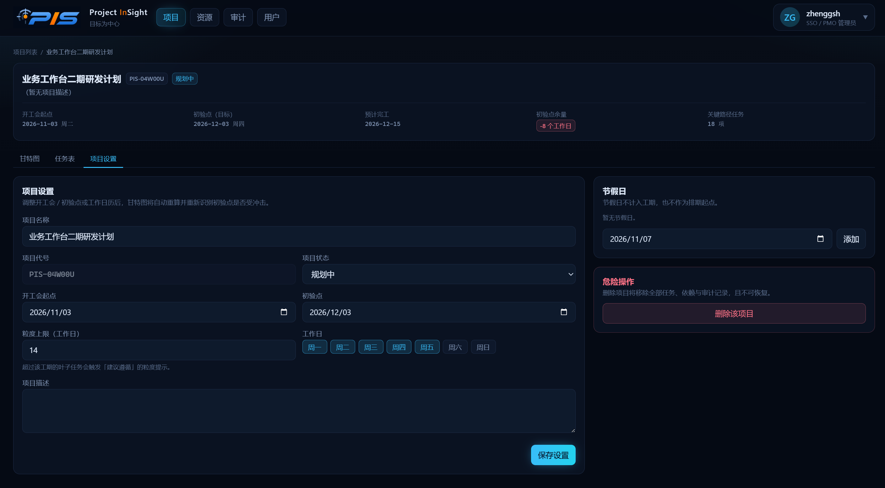
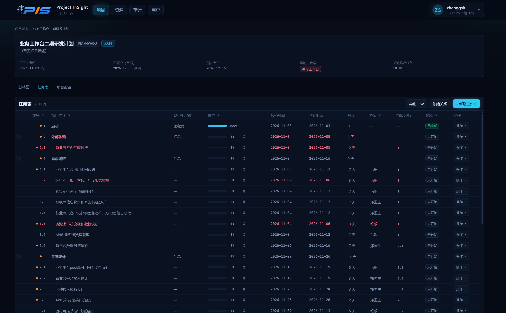
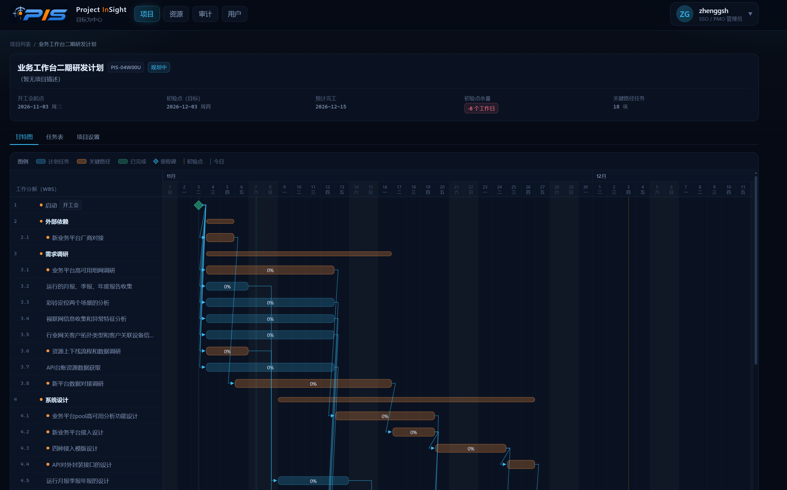
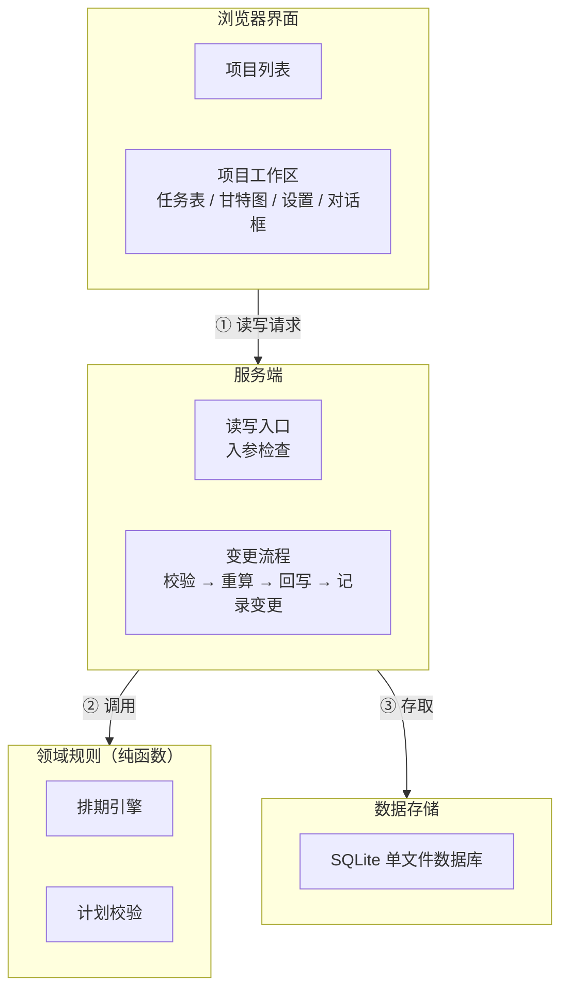
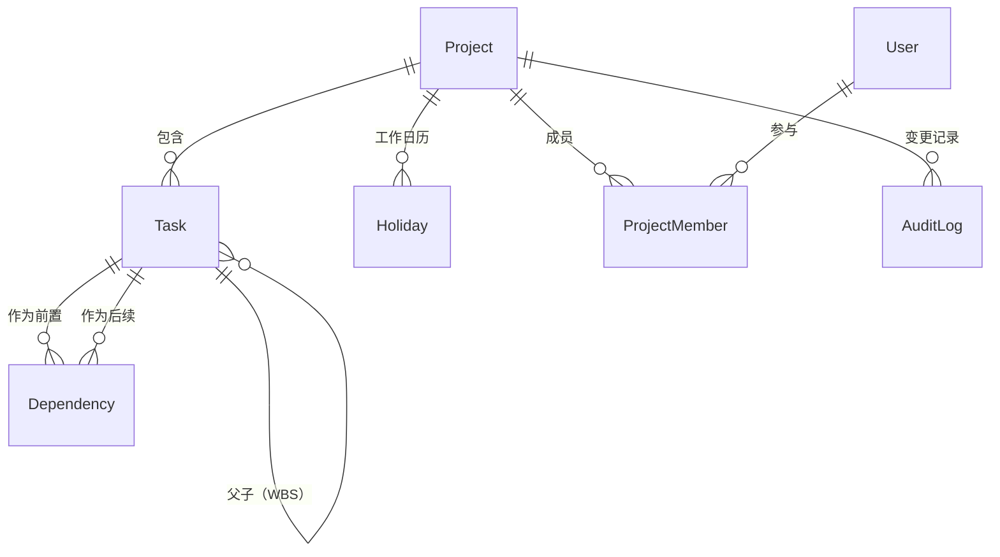

# Project InSight（PIS）

PIS 是一个面向小团队的项目计划制定与追踪 Web 应用,基于实用的项目管理经验，提供简单、高效、可扩展的项目管理功能。

## 1. 设计背景

原始需求是「实现项目计划的制定和追踪」，使用Project太繁重，使用Excel无法处理依赖，而且两者都无法实现通过web进行团队协作；
所以，为了指定某个项目的计划，直接使用Trae开发一个Web版本的项目计划制定与追踪工具，实践最有用的项目管理经验；

## 2. 计划管理经验
项目管理的计划管理的范畴大，但下面展开最基本、最实用的方法，主要包含
1. 如何拆解任务，将总体目标拆分为多个小目标，如果确保拆解时合理的？
2. 如何将拆解的任务是可执行的，依赖关系是合适的？
3. 如何在计划的执行过程中进行追踪计划，调整计划，识别计划风险？
4. 目标可能延期，应该如何处理？

### 2.1. 任务分解（WBS分解）
1. 计划总目标分解成N个小目标，无论是大目标还是小目标，必须是可测量的，有明确的完成标准；
2. 目标分解的同级之间，一定是并列的兄弟关系，避免出现男人，女人，老人这样的分解；
3. 要问自己完成了N个小目标是否完整了大目标；同样的，N个小目标进一步分解到多个小小目标
4. 要渐进明细，对两周内的工作，要分解到两三天粒度，两周后的工作可进行粗粒度处理，逐步分解；
**输出物**：工作分解WBS和基本的顺序。这里基本就识别了工作范围和事项拆解

### 2.2 任务起点终点，和中间任务项目的依赖关系
1. 起点：一般用个“开工会”作为起点，这个也是依赖的总起点
2. 终点：任务的完成时间，在安排好WBS和依赖后，务必紧盯这个终点
3. 任务的逻辑依赖（先设计再研发）
4. 任务的资源依赖（同一个负责人）
**输出物**：计划的静态版。这里，经过任务分解、设置起点、终点和依赖，就可以开始进行任务追踪了；


### 2.3. 任务追踪
计划就是用来变的，就是用来更新的，有两种必须的更新
1. 变化带来的更新，因为人员变、需求变、条件变，资源变，等等变化，要及时刷新，并在刷新时考虑对目标带来的变化；
2. 渐进明细带来的更新，因为看不清两周后的工作，原来计划的时间范围大，随着时间的推移，逐渐将任务分解到更细粒度，更准确的时间点；

计划变更的原则
1. 计划就是用来更新的，计划更新的过程就是保证任务终点完成的过程；
2. 最终目标是不能改变的，改变最终目标已经超出项目经理的职责范围；若不得不改变目标，必须向上沟通并得到批准；
3. 某项任务不能到最后一天才发现，因某种原因不能完成，必须提前识别，否则谁也没有办法完成这个任务；
4. 更不能存在过去时间点的任务；经常有项目经理投诉，你看这是上个月要完成的，现在还没有做完。（这个逻辑是不成立的）
5. 在追踪过程中，只能调整时长和依赖关系，不能手工调整开始时间和终止时间. 如果发现影响总进度和关键里程碑，就要采取措施
**输出物**：不断调整的计划。一般的一周至少两次调整，人员的工作目标和进展，执行风险至少要通过周报通报，关键期日报通报；


### 2.4. 赶工万能6条措施，计划变更造成了目标可能延期怎么办
1. 延迟工作时长，延迟每天和周末的时间
2. 任务并行，多项任务同时行，切开关键路径任务
3. 减范围，时间不能变，质量不能变，能变的只有范围
4. 用好资源和设备；
5. 用专家力量；
6. 好方法提高质量（减少返工）
**输出物**：赶工强化后的计划。


## 3. 主要功能

### 3.1. 项目管理
#### 3.1.1. 项目列表 
列表可新建、删除项目。新建时填写名称、可选代号、描述、开工会、初验点.



#### 3.1.2. 任务分解


**工作分解** 
1. 任务类型为汇总（SUMMARY）、工作项（TASK）、里程碑（MILESTONE）。
2. 任务表支持行内改名称、时长、资源（自由文本）、前级依赖和进度；
3. 可以上移、下移、缩进、升级、在下方插入同级任务。
4. 缩进时若上一兄弟不是汇总节点，会把它提升为 SUMMARY，并把原来挂在它身上的依赖边转接到新子任务，避免后续任务突然失去前级。
5. WBS 编码在结构变化后按显示顺序重算。
6. 新增汇总任务，会自动添加一个空的子任务，方便用户后续添加子任务。
6. WBS 编码在结构变化后按显示顺序重算。

**任务依赖设置** 
通过按照逻辑依赖和资源依赖，设置任务之间的依赖关系，使得项目中的任务可以从开头到终点的完整路径；

#### 3.1.2. 任务跟踪与调整
**任务调整** 
1. 根据时间的推移，要检查任务的进度是否完成，有延期风险提前预见，界面通过颜色对以延期、即将延期、有进展、已完成的任务采用不同颜色的标识；
2. 随着时间推荐，以前粗粒度的结合要渐进明细，拆分为更细粒度的任务。
3. 任务调整避免直接调整开始时间和结束时间，而应通过调整时长和依赖关系来实现；
4. 每次调整后，会自动重算相关依赖任务的开始时间和结束时间，确保关键的任务不被延迟；

**甘特图与导出** 
1. 甘特图为自研渲染：左侧 WBS 列，右侧按日时间轴，周末与节假日用底色区分；
2. 条形表示任务（关键路径、已完成用不同颜色，条内按进度填充），菱形表示里程碑，SVG 折线表示依赖，虚线标出开工会、初验点和今日。



### 3.2. 团队管理
**成员管理** 
实现项目下成员和组织的管理，包括添加、删除、修改成员信息。

**成员看板** 
实现团队成员看板管理，按照团队或者团队成员的工作台。左30%区域是“已完成任务”；右边70%是“待办任务”区；
看板的待办任务区，使用四现象法展示待办任务：
第一象限（左上角），重要且紧急，已经延期，以及即将延期的工作（1天内），这里的必须完成；
第二象限（右上角），重要不紧急，未到延期时间的工作，设计工作，预演工作，这里的可从容思考，仔细完成，不能拖，否则就拖成了重要且紧急；
第三象限（左下角），紧急不重要，作为第2责任人即将延期工作，这里的被驱动着完成；
第四象限（右下角），不重要不紧急，其他工作，这里的工作，关注即可。

## 4. 主要系统架构和实现
### 4.1. 系统架构

PIS 从上到下由四部分组成：浏览器界面、服务端、领域规则与数据存储。



**组成部分**

- **浏览器界面**：用户看到的全部页面与交互，只负责展示和收集输入，不直接访问数据库。
- **服务端**：唯一的读写入口，接收界面请求、检查入参，并串联「校验 → 重算 → 回写 → 记录变更」的完整流程。
- **领域规则**：排期引擎与计划校验两套纯逻辑，不依赖界面与数据库，可以单独测试。
- **数据存储**：单文件的 SQLite 数据库，保存项目、任务、依赖、节假日与此前的变更记录。

**各部分如何交互**

- **读（打开项目）**：界面请求工作区数据 → 服务端从数据库取数 → 用领域规则重新算一遍排期 → 组装成视图返回界面。因此页面上的日期总是按当前计划当次算出的结果。
- **写（新建项目、改工期、调依赖、缩进等）**：界面发起操作 → 服务端先检查入参，再让领域规则校验计划并重算排期，全部通过后才写回数据库并记下一条变更，最后通知界面刷新。
- 校验不通过时，服务端会阻止这次写入并回滚，把原因返回界面提示；若只是「建议遵循」的提示项，则需用户确认后再提交一次。

### 4.2. 目录结构

目录划分与架构分层一一对应：页面、界面、服务端、领域规则、数据各归一处。一个功能的改动通常只落到一到两层，定位问题或评审代码都能先靠目录判断。

```
src/
  app/          页面与路由
  components/   界面组件
  server/       服务端读写逻辑
  lib/          领域规则（排期与校验）
prisma/         数据模型定义
```

**页面（app/）** 负责路由与页面装配：项目列表页、项目工作区页，以及全局骨架（顶栏与导航）。这里只取数据和组装页面，不含业务规则。
**界面（components/）** 是全部可视组件，按复用范围分三块：项目列表、项目工作区（任务表、甘特图、依赖、设置、对话框），以及跨页面复用的通用小件。
**服务端（server/）** 是唯一的读写入口，客户端不直接碰数据库。写操作在这里完成「校验 → 重算 → 回写 → 记录变更」的一整套流程；读操作则读库后重新算一遍排期再交给界面。
**领域规则（lib/）** 放与框架无关的纯规则，主要是排期引擎和计划校验两套逻辑；服务端与单元测试用的是同一份代码，规则因此能被测试锁住。
**数据（prisma/）** 用一个 schema 文件定义全部数据模型（项目、任务、依赖、节假日、审计记录等）；数据库是单文件的 SQLite，建表通过同步命令完成，无需单独部署数据库服务。
**根目录与其它目录。** 根目录放项目的配置与脚本（依赖清单、构建、测试、数据库命令等），`docs/` 放系统设计文档，`mydoc/` 放这份使用说明及其配图，`public/` 放静态资源。

### 4.3. 技术栈

PIS 的技术栈遵循两条原则：一门语言贯穿前后端，省去接口层的工作；核心的计划规则写成纯函数，能被测试逐条锁住。下面只说每项技术的主要作用与在 PIS 中的应用。

- **Next.js** —— 前后端一体的 Web 框架，页面能直接取数，写操作也不必另开接口。PIS 的项目列表页、工作区页，以及新建项目、调整任务等操作都在同一套代码里完成。
- **React + TypeScript** —— 组件化搭界面，静态类型描述 WBS 树、依赖图这类结构化数据。PIS 的任务、依赖与排期结果都有明确类型，前后端共用同一份定义，重构时由编译器兜底。
- **Tailwind CSS** —— 原子化样式，设计令牌集中一处即可全局统一。PIS 的任务表、甘特图、对话框等界面风格由它统一，换肤只需改一处。
- **Prisma + SQLite** —— 类型安全的数据库访问搭配单文件数据库，无需单独部署数据库服务。PIS 的数据模型统一在一个 schema 中定义，很适合小团队自托管与本地开发。
- **Vitest** —— 轻量的单元测试框架，贴合纯函数写法。PIS 用它对排期与校验规则做完整覆盖，规则改坏时能立刻发现。
- **zod** —— 声明式的入参校验，一处定义、前后端复用。PIS 已将其列入依赖，规划用于收敛各操作入口的入参格式（当前校验仍写在操作入口内部）。

### 4.4. 数据架构

PIS 的数据对象不多，围绕「项目 → 任务树 → 依赖」展开，另配工作日历、成员与变更记录。



**主要对象与主要属性**

- **Project（项目）**：一个计划的总容器。主要属性有名称与代号、状态、开工会起点与初验点，以及工作日历（每周哪几天上班）和叶子任务工期上限。
- **Task（任务）**：WBS 树的节点，用父节点引用自关联成树，类型分汇总、工作项、里程碑三种。主要属性有名称、类型、状态、工期，以及由排期引擎写入的计划起止、是否关键、总余量等派生字段，另有资源、进度与进展描述等人工填报字段。
- **Dependency（依赖）**：任务之间的前后关系。主要属性有前置任务、后续任务、依赖类型（v1 只用 FS）与滞后天数；同一组前置-后续唯一。
- **Holiday（节假日）**：项目工作日历的补充，按日期记录，排期时据此跳过非工作日。
- **ProjectMember 与 User（成员与用户）**：记录谁以什么角色参与项目。v1 未启用登录，仅预留结构。
- **AuditLog（变更记录）**：每次写操作留一条，记录操作类型、作用目标与变更内容快照。

**关系说明**

- 一个项目包含一棵以开工会为根的任务树、若干条依赖，以及自己的节假日、成员与变更记录。
- 任务通过父子引用组成 WBS 树；依赖则在同项目的两个任务之间建立前后关系。
- 删除项目会级联删除其下的任务、依赖、节假日与变更记录。

设计文档另预留了基线快照、计划质量扫描报告与任务分配表等对象，v1 尚未落地。

## 5. 下一步开发建议


1. **增加团队管理** 管理团队、用户、看板的管理；

2. **增加项目文档管理** 实现项目中各个阶段关联的文档管理，以及文档的版本控制和评审工程管理；

3. **项目审计管理** 项目进展核算、资源成本核算等；
